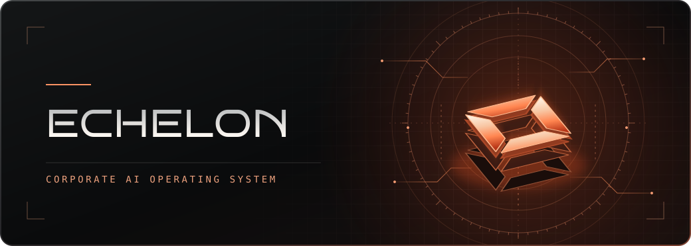

  

<h1 align="center">AI agents, on your infrastructure.</h1>

  Echelon is a self-hosted operating system for running AI agents across an organization. 
  Give agents a shared workspace, connect them to your tools, and put sensitive actions behind human approval.

  <a href="https://echelon-ai.space"><strong>Explore Echelon ↗</strong></a>
  &nbsp;&nbsp;·&nbsp;&nbsp;
  <a href="https://github.com/orgs/echelon-agents/repositories">Browse repositories ↗</a>

---

### Inside Echelon

| Layer | What it does |
| :--- | :--- |
| **Echelon Core** | Hosts agents, their shared workspace, and the approval queue on infrastructure your organization controls. |
| **Applications** | Extend what agents can do by connecting them to your organization’s tools and workflows. |
| **Channels** | Bring agents into conversations through chat, voice, and video. |
